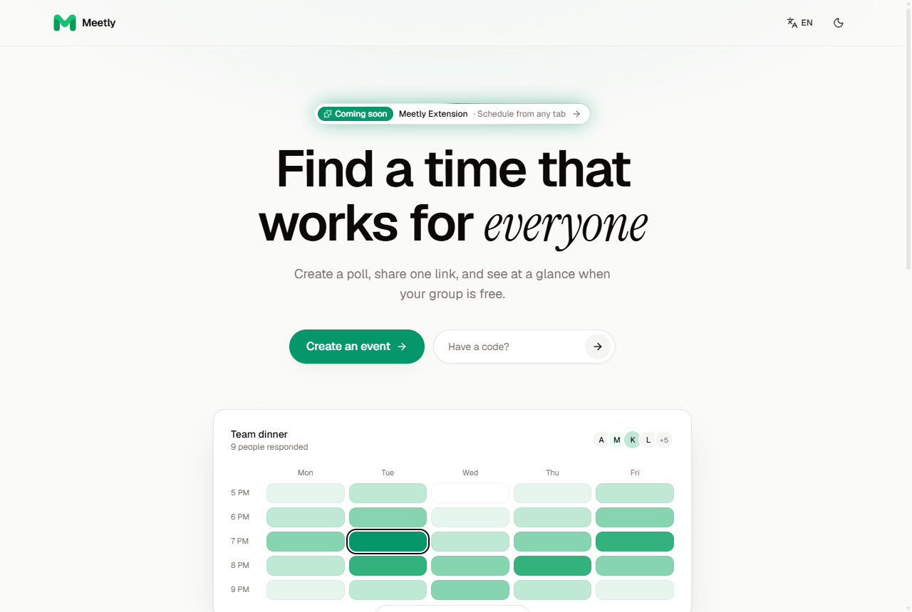
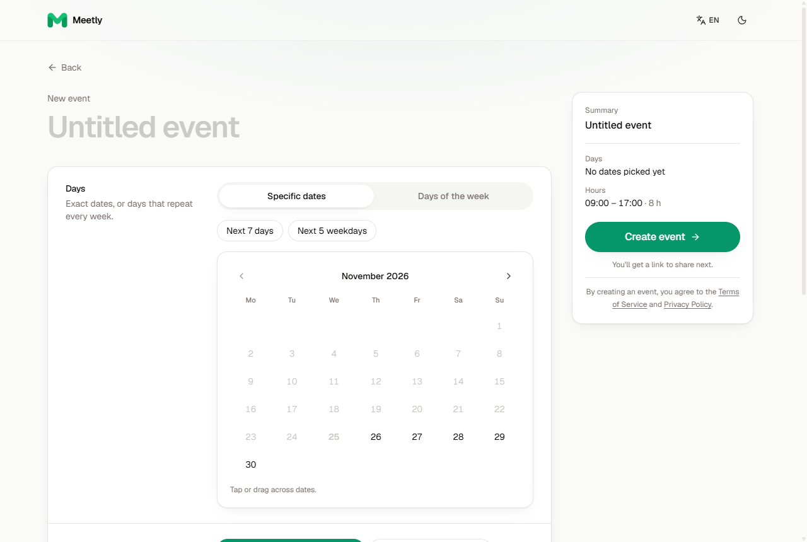
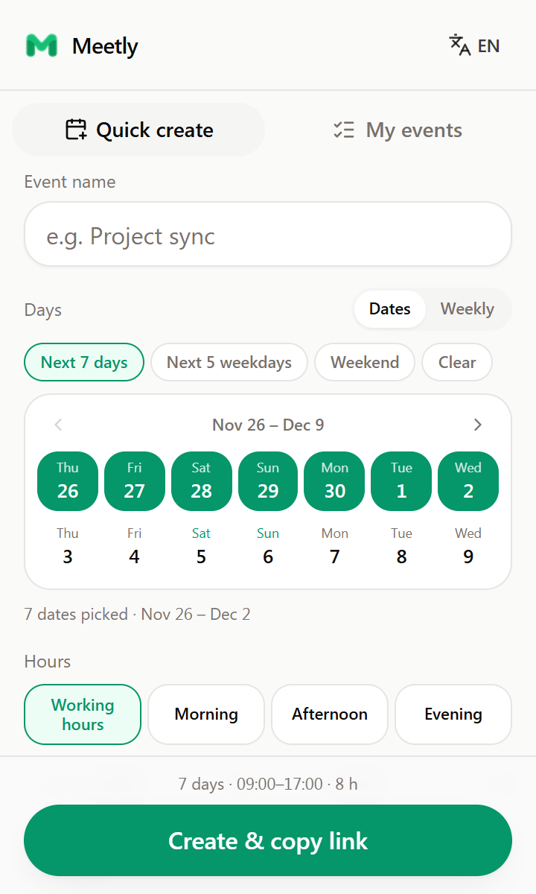
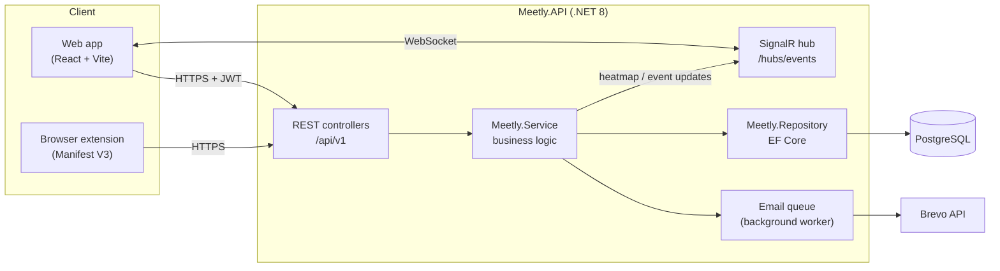

<div align="center">


# Meetly

**Find a time that works for everyone.**

Create a poll, share one link, and watch your group's availability fill a live heatmap.<br />
No accounts, no back-and-forth.

[**Live app**](https://meetly-soon.vercel.app) · [API contract](MEETLY_API_CONTRACT.md) · [Contributing](CONTRIBUTING.md) · [Report an issue](https://github.com/HKBDU/Meetly/issues)

[](https://github.com/HKBDU/Meetly/actions/workflows/quality.yml)
[](LICENSE)


<br />

<picture>
  <source media="(prefers-color-scheme: dark)" srcset="docs/images/home-dark.png" />
  
</picture>

</div>

---

## Table of contents

- [Features](#features)
- [How it works](#how-it-works)
- [Tech stack](#tech-stack)
- [Architecture](#architecture)
- [Getting started](#getting-started)
- [Configuration](#configuration)
- [Scripts](#scripts)
- [Browser extension](#browser-extension)
- [Deployment](#deployment)
- [Project structure](#project-structure)
- [Contributing](#contributing)
- [License](#license)

## Features

| | |
|---|---|
| 🗓️ **Flexible polls** | Pick specific dates or days that repeat every week, with any daily time range in 15-minute slots. Quick picks for "next 7 days", working hours, evenings and more. |
| 🖌️ **Drag to paint** | Participants mark when they are free (or busy) by dragging across a time grid, on desktop or mobile. Changes save automatically. |
| 🔥 **Live heatmap** | Everyone's availability is combined into a heatmap that updates in real time over SignalR as people respond. |
| ✨ **Best times** | Ranked suggestions for the meeting length you need, with "must include" participants. Finalize a slot in one click. |
| 🔔 **Email when it's decided** | Participants can opt in to an email the moment the host finalizes the time. |
| 🔐 **No sign-up** | Join with just a display name. Hosts protect edits and finalizing with a password; sessions use short-lived JWTs. |
| 🌐 **English & Vietnamese** | Full i18n, including dates, weekdays and validation messages. Light and dark themes. |
| 🧩 **Browser extension** | Create a poll from the toolbar and copy the link without leaving the page you are on. |

<p align="center">
  
  &nbsp;
  
</p>

## How it works

1. **Create** an event: name it, choose the days and the daily hours, and set a host password.
2. **Share** the link or the 6-character event code with your group.
3. **Collect** availability: each person joins with a name and paints the slots that work for them.
4. **Decide**: the heatmap and *Best times* show where everyone overlaps. The host finalizes a slot, the event locks, and subscribers get an email.

## Tech stack

| Layer | Technology |
|---|---|
| **Frontend** | React 19, TypeScript, Vite, Tailwind CSS v4, Radix UI, TanStack Query, Zustand, React Hook Form + Zod |
| **Realtime** | ASP.NET Core SignalR (optional Redis backplane for multiple instances) |
| **Backend** | .NET 8 Web API, Entity Framework Core, JWT bearer auth, rate limiting, response compression |
| **Database** | PostgreSQL 16 (Npgsql) |
| **Email** | Brevo transactional API, sent from a background queue with retries |
| **Extension** | Chrome Manifest V3, built with Vite from the shared frontend code |
| **Tooling** | ESLint, Prettier, `dotnet format`, xUnit, Node test runner, GitHub Actions, Docker |

## Architecture



The backend follows a layered design across four projects:

- **`Meetly.API`**: controllers, SignalR hub, middleware, auth and rate limiting.
- **`Meetly.Service`**: business rules (events, availability, suggestions, email, JWT).
- **`Meetly.Repository`**: EF Core `DbContext`, entities, migrations and data access.
- **`Meetly.Contract`**: shared DTOs and the API response envelope.

Every change to an event bumps a **revision** number. Realtime payloads carry it, so clients drop stale or duplicated updates and stay consistent even across reconnects.

## Getting started

### Prerequisites

- [Node.js 22+](https://nodejs.org)
- [.NET 8 SDK](https://dotnet.microsoft.com/download/dotnet/8.0)
- [Docker](https://www.docker.com) (for PostgreSQL), or a PostgreSQL 16 instance of your own
- EF Core CLI: `dotnet tool install --global dotnet-ef`

### 1. Clone and start the database

```bash
git clone https://github.com/HKBDU/Meetly.git
cd Meetly
cp .env.example .env          # optional: change the Postgres credentials
docker compose up -d          # PostgreSQL 16 on localhost:5432
```

### 2. Configure and run the backend

Create `backend/src/Meetly.API/appsettings.json` (it is git-ignored, see [Configuration](#configuration)), then apply the migrations and start the API:

```bash
cd backend
dotnet ef database update --project src/Meetly.Repository --startup-project src/Meetly.API
dotnet run --project src/Meetly.API --launch-profile http
```

| Endpoint | URL |
|---|---|
| REST API | `http://localhost:5010/api/v1` |
| Swagger UI (Development only) | `http://localhost:5010/swagger` |
| SignalR hub | `http://localhost:5010/hubs/events` |
| Health check | `http://localhost:5010/health` |

### 3. Run the frontend

```bash
cd frontend
cp .env.example .env
npm install
npm run dev
```

Open **http://localhost:5173** and create your first event.

## Configuration

### Backend

ASP.NET Core reads `appsettings.json` and environment variables. When using environment variables, replace `:` with `__` (for example `Brevo__ApiKey`).

```jsonc
{
  "ConnectionStrings": {
    "DefaultConnection": "Host=localhost;Port=5432;Database=meetly_db;Username=postgres;Password=postgrespassword"
    // "Redis": "localhost:6379"   // optional SignalR backplane
  },
  "JwtOptions": {
    "SecretKey": "<at least 32 random characters>",
    "Issuer": "meetlyServer",
    "Audience": "meetlyClient",
    "ExpirationMinutes": 600
  },
  "App": { "FrontendBaseUrl": "http://localhost:5173" },
  "Cors": { "AllowedOrigins": ["http://localhost:5173"] },
  "Brevo": {
    "ApiUrl": "https://api.brevo.com/v3/smtp/email",
    "ApiKey": "<xkeysib-...>",
    "SenderName": "Meetly",
    "SenderEmail": "<verified sender address>"
  },
  "ForwardedHeaders": { "Enabled": false }
}
```

| Key | Description |
|---|---|
| `ConnectionStrings:DefaultConnection` | PostgreSQL connection string. **Required.** |
| `ConnectionStrings:Redis` | Optional. Enables the SignalR Redis backplane when running more than one API instance. |
| `JwtOptions:*` | Signing key and lifetime of participant access tokens. Use a long random secret in production. |
| `App:FrontendBaseUrl` | Public web URL, used for event links in API responses and emails. |
| `Cors:AllowedOrigins` | Origins allowed to call the API. |
| `Brevo:*` | Transactional email settings. The API key must be a Brevo **API key** (`xkeysib-…`), and the sender must be verified in Brevo. |
| `ForwardedHeaders:Enabled` | Set to `true` only behind a trusted reverse proxy (Render, Nginx…) so rate limiting sees the real client IP. |

### Frontend

Defined in `frontend/.env` (see `frontend/.env.example`):

| Variable | Description |
|---|---|
| `VITE_API_BASE_URL` | Backend base URL, e.g. `http://localhost:5010`. **Required.** |
| `VITE_SIGNALR_HUB_URL` | SignalR hub URL, e.g. `http://localhost:5010/hubs/events`. **Required.** |
| `VITE_GA_MEASUREMENT_ID` | Optional Google Analytics 4 ID (`G-…`). Only loaded in production builds. |
| `VITE_CF_ANALYTICS_TOKEN` | Optional Cloudflare Web Analytics site token (cookieless). Only loaded in production builds. |
| `VITE_EXTENSION_STORE_URL` | Optional Chrome Web Store link of the extension. When set, the home page shows an "Add to Chrome" button instead of "Coming soon". |

## Scripts

Run from `frontend/`:

| Command | Description |
|---|---|
| `npm run dev` | Start the Vite dev server on port 5173 |
| `npm run build` | Type-check and build the production bundle |
| `npm run lint` | Lint with ESLint |
| `npm test` | Run frontend tests (Node test runner + Vite SSR) |
| `npm run build:extension` | Build the browser extension into `dist-extension/` |

Run from `backend/`:

| Command | Description |
|---|---|
| `dotnet build Meetly.sln` | Build all projects |
| `dotnet test Meetly.sln` | Run the xUnit test suite |
| `dotnet format --verify-no-changes` | Check formatting (enforced in CI) |

## Browser extension

The extension lives in [`frontend/extension`](frontend/extension) and reuses the web app's UI, i18n and API client.

```bash
cd frontend
npm run build:extension
```

Then open `chrome://extensions`, turn on **Developer mode**, click **Load unpacked** and select `frontend/dist-extension`.

It only requests the `storage` permission plus access to the Meetly API domain. See [`frontend/extension/PUBLISHING.md`](frontend/extension/PUBLISHING.md) for the full Chrome Web Store release checklist.

## Deployment

The production setup:

| Part | Platform | Notes |
|---|---|---|
| Web app | **Vercel** | Root directory `frontend`, SPA rewrites in `vercel.json`. Deploys from `main`. |
| API | **Render** | Root directory `backend`, built from `src/Meetly.API/Dockerfile`. Configure the backend settings above as environment variables. |
| Database | PostgreSQL 16 | Any managed Postgres. Apply migrations before releasing schema changes. |
| Email | **Brevo** | Disable "Block unauthorized IP addresses" for API keys, since Render has no fixed outbound IP. |

Every push and pull request to `main` or `dev` runs the [Quality Check](.github/workflows/quality.yml) workflow: frontend lint and build, backend formatting and tests.

## Project structure

```text
Meetly/
├── backend/
│   ├── src/
│   │   ├── Meetly.API/          # Controllers, SignalR hub, middleware, Program.cs, Dockerfile
│   │   ├── Meetly.Service/      # Events, availability, suggestions, email, JWT
│   │   ├── Meetly.Repository/   # DbContext, entities, repositories, migrations
│   │   └── Meetly.Contract/     # Shared DTOs and response envelope
│   └── tests/Meetly.Api.Tests/  # xUnit tests
├── frontend/
│   ├── src/
│   │   ├── app/                 # Router, layout, providers, error page
│   │   ├── features/            # events, participants, heatmap, legal
│   │   ├── shared/              # UI kit, API client, i18n, grid model, hooks
│   │   ├── lib/                 # axios, date/time helpers, analytics
│   │   └── styles/              # Tailwind theme and global styles
│   ├── extension/               # Browser extension (popup, storage, manifest)
│   └── tests/                   # Frontend tests
├── docs/images/                 # README screenshots
├── .github/workflows/           # CI pipeline
├── docker-compose.yml           # Local PostgreSQL
├── MEETLY_API_CONTRACT.md       # REST and realtime API reference
└── CONTRIBUTING.md              # Branching, commit and code conventions
```

## Contributing

Contributions are welcome. Branch from `dev`, follow [Conventional Commits](https://www.conventionalcommits.org) (`feat(heatmap): …`, `fix(email): …`) and open a pull request into `dev`. CI must pass before merging; `dev` is promoted to `main` for releases.

Read [CONTRIBUTING.md](CONTRIBUTING.md) for the full workflow and coding standards.

## License

Released under the [MIT License](LICENSE). © 2026 HKBDU.
